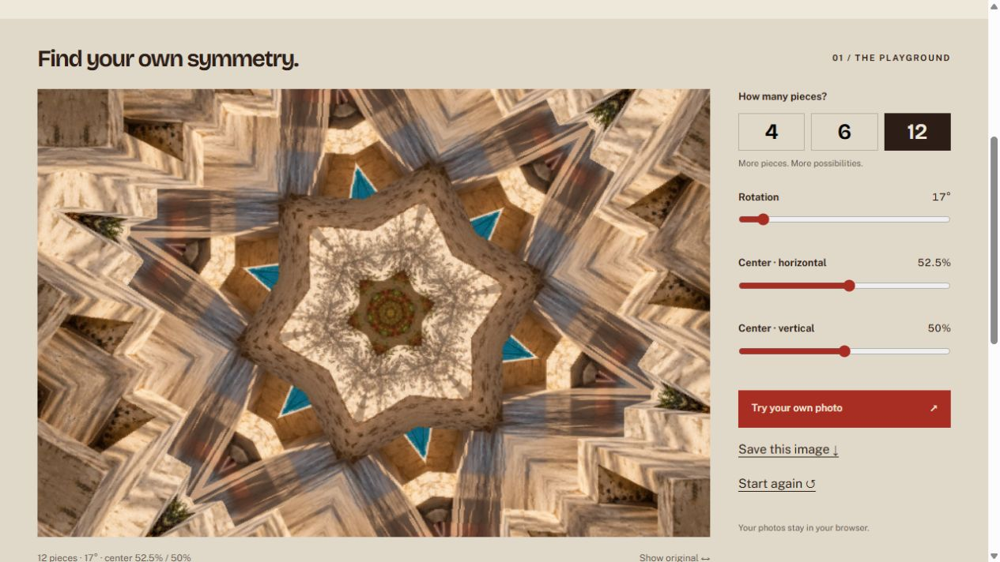

# Kaleido

**Turn the ordinary around.** A standalone kaleidoscope module for the original Canon EOS M, by **Max Seelig (MAXmade)**.

One wedge becomes a pattern: **4, 6 or 12 segments**, a full **360° rotation control**, and a movable center. Compose in LiveView; the implementation includes a whole-Bayer-cell native Canon CR2 capture path. Kaleido has its own `kaleido.mo`, Shoot menu and checked preference files. It derives from [Mirror Worlds](https://github.com/m-a-x-s-e-e-l-i-g/mirror-worlds).

**0.1.0-rc1 is a development candidate.** Host pixel, capture-transport and import checks are not physical-camera acceptance. Loading, responsiveness, RAW processing time, autofocus, Auto ISO, actual CR2 contents and Canon review/Play remain unverified on the EOS M.



*Browser illustration using the inherited AI-generated starting scene; not a camera photograph. The camera module uses no AI.*

## Try the playground

Open **[playground.html](playground.html)** in your browser. This standalone file needs no server or installation. Change segments, rotation and center, compare with the original, choose your own image and save a PNG. Photos stay in your browser. Browser RGB output illustrates the geometry; it does not emulate a sensor mosaic or prove camera output.

For website development:

```sh
python scripts/build_site.py
python -m http.server 8782 --bind 127.0.0.1 --directory .site-build
```

Open `http://127.0.0.1:8782/`. The assembly step includes the candidate download. No npm installation is required.

## Camera candidate

The target is **original EOS M / Canon 2.0.2 / Magic Lantern dev 2025-06-20 (ed3e7c0)**. Other cameras and builds are unsupported.

1. Read [the candidate instructions](docs/camera-candidate.md), then unzip [KALEIDO-0.1.0-rc1-EOSM202.zip](releases/KALEIDO-0.1.0-rc1-EOSM202.zip).
2. With the camera **OFF**, copy only `ML/MODULES/kaleido.mo` to the card. Keep the existing firmware and Magic Lantern core.
3. In ML's Modules tab, **disable all other MAXmade effect modules**, enable `kaleido.mo`, then fully restart. Kaleido refuses to start while an older sibling module is loaded, including one whose effect switch is OFF.
4. Use **A+ / Auto ISO / Canon RAW / single-shot / native 1× LCD / Global Draw ON**. Open **Shoot → Kaleido**, turn Live effect ON and choose the pattern.
5. Close the menu and use the physical shutter. Release it between shots. Allow processing to finish.

The first install starts OFF with 6 segments, 0° rotation and a centered origin. ON/OFF and all four geometry controls are saved in separate `kaleido0.prf` / `kaleido1.prf` slots.

The RAW path retains Mirror Worlds' conservative **two-second post-hoc capture limit**. A completed fold that exceeds it stops the effect for subsequent shots. This limit is not a watchdog guarantee; camera timing needs measurement before this can be called a validated shooting release.

## Build and verify

Python 3, Docker with Linux containers and Git are required for the camera build. Node.js is used only for playground tests.

```sh
python scripts/fetch_ml_build.py
python tools/build_module.py
python scripts/test_native.py --full
node --test tests/playground.test.mjs
python scripts/build_playground.py
python tools/package_module.py --instructions docs/camera-candidate.md
python scripts/verify_candidate.py
```

The packager refuses to overwrite an existing candidate. See [development notes](docs/development.md) and [verification evidence](docs/validation.md).

GPL-2.0-or-later. [License](COPYING) · [Credits](NOTICE.md)
