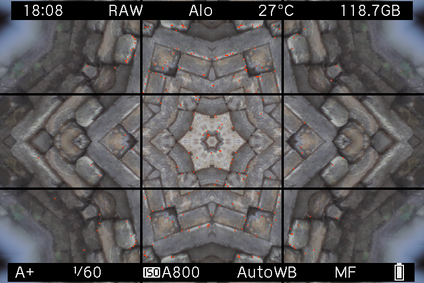
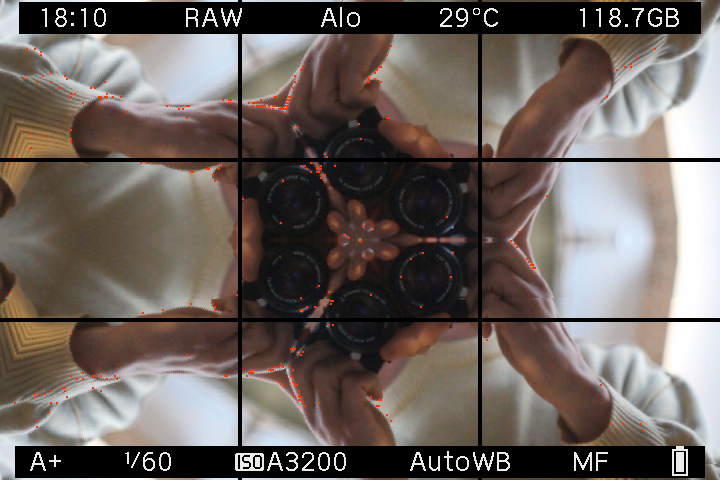
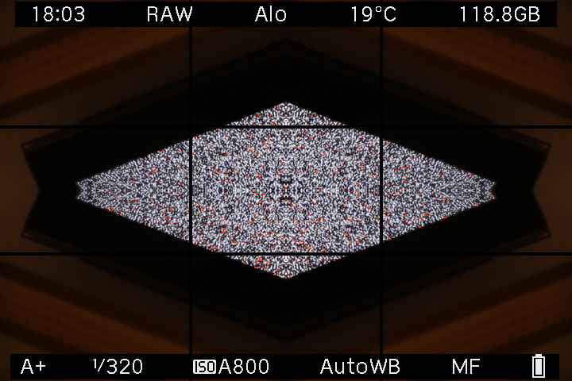
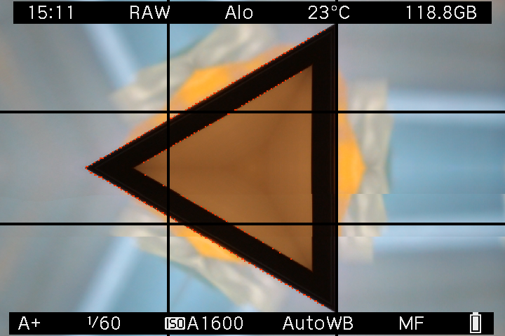
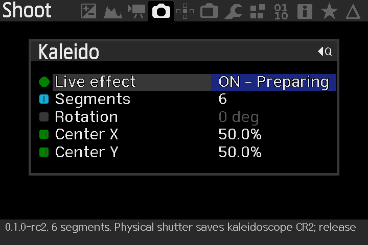

# Kaleido

**Turn the ordinary around.** A standalone kaleidoscope module for the original Canon EOS M, by **Max Seelig ([MAXmade](https://maxmade.nl/))**.

[Website & interactive playground](https://kaleido-eosm.netlify.app/) · [Download 0.1.0](https://github.com/m-a-x-s-e-e-l-i-g/kaleido/releases/tag/v0.1.0) · [Installation](docs/installation.md)

One wedge becomes a pattern: **4, 6 or 12 segments**, a full **360° rotation control**, and a movable center. Compose in LiveView; the implementation includes a whole-Bayer-cell native Canon CR2 capture path. Kaleido has its own `kaleido.mo`, Shoot menu and checked preference files. It derives from [Mirror Worlds](https://github.com/m-a-x-s-e-e-l-i-g/mirror-worlds).

**[First public release · 0.1.0](https://github.com/m-a-x-s-e-e-l-i-g/kaleido/releases/tag/v0.1.0).** Max Seelig reports that rc4 passed testing on the physical EOS M and works well. Version 0.1.0 retains that implementation; the build verifies that only the version label and module documentation changed. [Camera test report](docs/camera-test-report.json) · [Release notes](docs/release-0.1.0.md).

The release includes the faster tiled preview and full-precision RAW path, with a shared preview/RAW arena that saves 740,516 bytes. Switching between 4, 6 and 12 segments needs no new allocations. Existing rc4 preferences carry over.

## From the EOS M

| Stonework | A familiar face, repeated |
| --- | --- |
|  |  |
| **A screen within a screen** | **The pattern, on the camera** |
|  |  |
| **Kaleido settings** | |
|  | |

*Actual 720 × 480 EOS M screen captures, converted to lossless WebP without cropping. The settings screenshot shows the earlier 0.1.0-rc2 menu.*

## Browser playground


*Browser illustration using the inherited AI-generated starting scene; not a camera photograph. The camera module uses no AI.*

Open **[playground.html](playground.html)** in your browser. This standalone file needs no server or installation. Change segments, rotation and center, compare with the original, choose your own image and save a PNG. Photos stay in your browser. Browser RGB output illustrates the geometry; it does not emulate a sensor mosaic or prove camera output.

For website development:

```sh
python scripts/build_site.py
python -m http.server 8782 --bind 127.0.0.1 --directory .site-build
```

Open `http://127.0.0.1:8782/`. The assembly step includes the release download. No npm installation is required.

## Install on the camera

The target is **original EOS M / Canon 2.0.2 / Magic Lantern dev 2025-06-20 (ed3e7c0)**. Other cameras and builds are unsupported.

1. Read [the installation instructions](docs/installation.md), then unzip [KALEIDO-0.1.0-EOSM202.zip](releases/KALEIDO-0.1.0-EOSM202.zip).
2. With the camera **OFF**, copy only `ML/MODULES/kaleido.mo` to the card. Keep the existing firmware and Magic Lantern core.
3. In ML's Modules tab, **disable all other MAXmade effect modules**, enable `kaleido.mo`, then fully restart. Kaleido refuses to start while an older sibling module is loaded, including one whose effect switch is OFF.
4. Use **A+ / Auto ISO / Canon RAW / single-shot / native 1× LCD / Global Draw ON**. Open **Shoot → Kaleido**, turn Live effect ON and choose the pattern.
5. Close the menu and use the physical shutter. Release it between shots. Allow processing to finish.

The first install starts OFF with 6 segments, 0° rotation and a centered origin. ON/OFF and all four geometry controls are saved in separate `kaleido0.prf` / `kaleido1.prf` slots.

The RAW path retains Mirror Worlds' conservative **two-second post-hoc capture limit**. A completed fold that exceeds it stops the effect for subsequent shots. This is not a hard processing deadline. The author reports successful camera testing; no measured FPS or processing-time figures are claimed.

## Build and verify

Python 3, Docker with Linux containers and Git are required for the camera build. Node.js is used only for playground tests.

```sh
python scripts/fetch_ml_build.py
python tools/build_module.py
python scripts/test_native.py --full
node --test tests/playground.test.mjs
python scripts/build_playground.py
python tools/package_module.py --instructions docs/installation.md
python scripts/verify_candidate.py
```

The packager refuses to overwrite an existing release. See [development notes](docs/development.md), [0.1.0 verification](docs/validation-0.1.0.md) and the historical [rc4 verification evidence](docs/validation-rc4.md).

## Frequently asked questions

**What is Magic Lantern?**

[Magic Lantern](https://www.magiclantern.fm/) is a free, open-source extension that adds tools to supported Canon cameras. It loads from the memory card alongside Canon's software and is developed independently of Canon. Kaleido requires an existing compatible installation; see the [EOS M installation page](https://builds.magiclantern.fm/EOSM.html).

**Does it save real RAW files?**

Yes. The module transforms whole Bayer cells in the native Canon CR2 capture path. It is more than a display overlay. The browser playground is a separate RGB illustration.

**Can I use autofocus and Auto ISO?**

The normal Canon shutter workflow remains in charge. Use the supported A+ / Auto ISO setup above and release the shutter between single shots.

**Are settings remembered?**

Yes. Live effect, segments, rotation and center save automatically in Kaleido's own preference files.

**Does it support video or bursts?**

This release supports single-shot Canon RAW. Video, bursts, remote triggers and long exposures are outside its supported workflow.

**Why won't LiveView start?**

Check the camera/core versions, native 1× LCD and Global Draw. Disable other MAXmade effects in Modules and restart, even if their effect switches were OFF. See [troubleshooting](docs/installation.md#troubleshooting) or [open an issue](https://github.com/m-a-x-s-e-e-l-i-g/kaleido/issues).

## Prefer simpler mirrored effects?

Try **[Mirror Worlds](https://mirror-worlds.netlify.app/)**, another standalone module by [MAXmade](https://maxmade.nl/) for simple reflections and mirrored borders on the EOS M. Enable one effect module at a time.

GPL-2.0-or-later. [License](COPYING) · [Credits](NOTICE.md)
